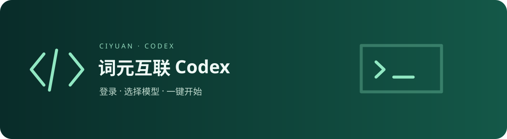

# 词元互联 Codex · Ciyuan Codex

登录 → 选择模型 → 一键应用并启动。基于 Tauri v2 的 Sub2API 账户客户端与官方 Codex 桌面管理器。

Sign in, choose a model, then apply and launch Codex. A Tauri v2 account client and desktop manager for Windows and macOS.

[下载安装包 / Downloads](https://github.com/ccfwwm/ciyuan-codex/releases/latest) · [隐私](docs/privacy.md) · [验收记录](docs/ciyuan-validation.md) · [签名状态](docs/code-signing-policy.md)

## 开始使用

1. 从 Releases 下载对应架构的 EXE 或 DMG 安装包并安装。
2. 在「主页」安装或升级官方 Codex；连接要求内置 CLI 至少为 **0.156.1**，应用会自动预检。
3. 在「AI 平台」登录或注册，进入「模型连接」选择可用分组和模型。
4. 点击「验证、应用并启动」。通过流式输出与工具调用验证后，应用备份并合并配置，再启动 Codex。

| 节点 | 地址 |
| --- | --- |
| 中转直连（默认） | https://code.aicodeme.xyz |
| 词元互联中转 | https://code.aicodeme.cn |
| 中转香港 | https://hkcode.aicodeme.xyz |

三个节点共用账户；切换时验证会话，失败保留原节点。账户页提供 USD 余额、低余额提醒和当前节点使用记录。充值页按服务器返回的渠道、币种、限额及手续费创建二维码订单并自动刷新。忘记密码可发送邮件，通过平台邮件链接重置。

首版开放已验证的 gpt-5.6-sol、gpt-5.6-terra、gpt-6-astra、gpt-6-sol、gpt-6.1-sol。实际可用性取决于分组与额度。验证请求正常计费。平台要求人机验证、邀请码或二次验证时，应用说明限制并引导使用网页或专用账户。

## 配置与凭据

- 会话和 API Key 保存在 Windows 凭据管理器 / macOS Keychain；密码不长期保存。默认记住登录，退出后停止恢复。
- 每个分组使用本应用专用 Key，保留其他客户端 Key。
- 只管理独立 provider、模型和模型目录字段，保留项目、MCP、权限及原登录文件。支持恢复；外部修改时暂停覆盖。
- Codex 通过管理器无界面凭据命令读取 Key。卸载前请恢复配置；已连接时不要移动管理器可执行文件。
- 应用标识、数据目录和更新签名独立于上游。管理的是同一套官方 Codex 安装，多个管理器的安装操作请依次执行。

## 下载与签名

Releases 提供 Windows x64 / ARM64、macOS Intel / Apple Silicon 安装包，以及更新工件、latest.json 和 SHA256SUMS。更新源为本仓库 GitHub Releases。

Windows 首版无 Authenticode 发行证书；macOS 使用 ad hoc 签名，未进行 Apple 公证。Tauri 更新签名验证下载字节，不代表系统发行者身份。系统可能提示未知发行者，请核对下载来源与 SHA-256。

## 开发

安装依赖 npm ci；检查 npm run check、npm run lint、npm test；运行 npm run tauri:dev。Rust 工作区位于 crates/ 和 src-tauri/。正式安装包由 GitHub Actions 原生构建，版本 tag 驱动发布。website/ 与 cloudflare/ 保留上游源码供参考，本项目不自动部署这些服务。

## English

Install the release for your architecture. Install/update official Codex, sign in on AI Platform, choose a group and model, then verify, apply and launch. Sessions and dedicated keys use the OS credential vault. Configuration merges preserve projects and MCP settings and support restoration. Billing limits and payment status come from the platform. Usage opens the selected route's /usage page through normal browser sign-in.

The first release is unsigned on Windows and ad hoc signed without notarization on macOS. Updater signatures authenticate bytes only. Four architectures are built with GitHub Actions and distributed through GitHub Releases.

## 上游与许可 · Credits & License

基于 [Wangnov/Codex-App-Manager](https://github.com/Wangnov/Codex-App-Manager)，保留上游历史和 [MIT 许可](LICENSE)。感谢原贡献者的安装、更新、皮肤和打包实现。账户流程参考 ZeroWallScience，在 Tauri 中独立实现，不引入 Electron / DSH。官方 Codex 属于 OpenAI，本项目为独立第三方管理器。
